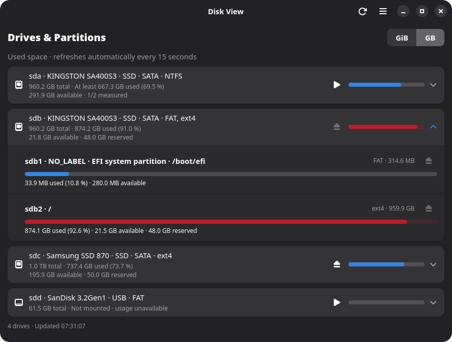

<div align="center">
  
</div>

# Disk View

[](https://github.com/magynhard/disk-view.cr/releases)
[](https://crystal-lang.org/)
[](https://www.gtk.org/)
[](https://gnome.pages.gitlab.gnome.org/libadwaita/)
[](#requirements)
[](LICENSE)

A small GTK4/libadwaita application written in Crystal for Linux.
The interface follows your system language. Disk usage is displayed using
native horizontal GTK progress bars.

> If all you want is a quick, simple overview of your drives and how much space
> you're using, Disk View is for you.



## Features

- Mounted local filesystems and common network mounts, including total, used,
  available and reserved space when reported by the filesystem.
- Unmounted disks and partitions, including their capacity. Usage becomes
  available after mounting a filesystem using its mount button or another app.
- Mount/unmount buttons on each partition and a collective button per drive.
  A mixed drive mounts its remaining eligible filesystems; when all are mounted,
  the collective action unmounts them. Operations run asynchronously in sequence.
- Filesystem types and volume labels from the udev cache, including unmounted
  NTFS/exFAT/FAT volumes. Windows data, Microsoft reserved (MSR), recovery and EFI
  partitions are identified by their partition types. BitLocker containers are
  marked locked or mapped.
- Drive connection labels (SATA, NVMe, USB and SD/MMC) when identified, with
  SSD/HDD media where reported by the kernel. USB devices and SD/MMC media show
  only their connection because their rotational flags can be unreliable.
- Compact drive groups (`sda`, `sdb`, NVMe, etc.) with indented partitions,
  physical drive capacity and aggregated filesystem usage. Partial totals are
  explicitly marked when some partitions cannot be measured.
- Native Adwaita expander rows start collapsed. Click a drive to reveal its
  partitions; your expansion choices are preserved across refreshes in the
  current session.
- Bind mounts and subvolumes of the same filesystem are grouped together.
- Linked GiB/GB toggle buttons next to the content heading switch between binary
  (base 1024) and decimal (base 1000) sizes. All capacities, usage figures and
  tooltips update immediately without rescanning drives or collapsing expanded
  groups. Decimal units (GB) are the default; the last selected unit is saved
  automatically and restored on the next launch.
- Automatic refresh every 15 seconds and a manual refresh button.
- Light and dark appearance follow the system preference, including live changes,
  using libadwaita's default color scheme.
- Asynchronous filesystem queries so slow network mounts do not block the UI.
- Runs as a normal desktop application. Mount/unmount requests use UDisks2 and
  the system's polkit authorization dialog.
- Original scalable application icon, desktop launcher and an Adwaita About
  dialog with author, version and license information.
- English, German, French, Spanish, Simplified Chinese, Russian, Italian,
  Polish, Korean and Japanese translations, selected using your system locale.

## Requirements

Linux and a graphical session. Mount/unmount actions additionally require
UDisks2, a system D-Bus and a desktop polkit authentication agent. Discovery and
usage display work without UDisks2.

## Install

Download the Linux x86_64 AppImage or standalone Flatpak bundle from
[GitHub Releases](https://github.com/magynhard/disk-view.cr/releases). Both include
all ten application languages and have separate SHA-256 files.

The AppImage bundles GTK4, libadwaita and the other application libraries. It
requires glibc 2.39 or newer. Make the downloaded file executable and run it:

```sh
chmod +x Disk_View-VERSION-x86_64.AppImage
./Disk_View-VERSION-x86_64.AppImage
```

Replace `VERSION` with the downloaded version. If FUSE is unavailable, append
`--appimage-extract-and-run` to the run command.

The Flatpak bundle requires Flatpak 1.17 or newer and the GNOME Platform 51
runtime. Install and run it with:

```sh
flatpak remote-add --user --if-not-exists flathub https://flathub.org/repo/flathub.flatpakrepo
flatpak install --user flathub org.gnome.Platform//51
flatpak install --user Disk_View-VERSION-x86_64.flatpak
flatpak run de.magynhard.DiskView
```

For building and installing from source, see [Contributing](CONTRIBUTING.md).

## Usage

Use the header-bar menu for **About Disk View**, refresh and close. Keyboard
shortcuts: `Ctrl+R` to refresh, `F1` for About, and `Ctrl+W` to close.

The GiB/GB buttons next to the content heading select the size units. The choice
is stored in `$XDG_CONFIG_HOME/disk-view/size-unit`, or
`~/.config/disk-view/size-unit` when `XDG_CONFIG_HOME` is unset. Flatpak uses its
own application configuration directory automatically.

The play/eject buttons mount and unmount filesystems. Reserved partitions, locked
encrypted containers, swap, mapped backing devices and running system mounts
such as `/` and `/boot/efi` are excluded. Current mount points are rechecked via UDisks
before each operation. Busy filesystems fail normally; no forced unmount is used.
Other mount buttons are disabled while a batch is running. The view refreshes
after completion, preserving expanded groups. If one operation fails, remaining
operations are attempted and the individual failures are shown; completed
operations are not rolled back. Closing the window or dismissing a polkit
authorization dialog stops subsequent requests.

## Translations

GNU gettext selects the interface language at startup using `LANGUAGE`,
`LC_ALL`, `LC_MESSAGES` and `LANG`. Unsupported languages fall back to English;
the `C` and `POSIX` locales use English. The requested system locale must be
installed on the machine. GTK/Adwaita also use their own system translations.

## Scope

Discovery uses `/proc/self/mountinfo`, `/proc/swaps`, `/sys/class/block` and
libudev cached device properties. Metadata is read without mounting, unlocking
or directly probing drives. If udev has no cached identification data, the
application still lists devices using sysfs and mounted-filesystem information.
NTFS drivers such as `ntfs3` and `ntfs-3g`/`fuseblk` are displayed as NTFS when
identified; disk usage is read through the existing mount, just like for Linux
filesystems. Drive letters such as `C:` are Windows configuration, not inferred
from NTFS or partition labels. Filesystem-less MSR partitions are excluded from
usage totals; unmounted data and recovery partitions remain explicitly unknown.
Pseudo-filesystems, RAM disks and loop/Snap images are hidden. Partitions are
grouped using sysfs parent relationships, with numeric partition ordering.
Mapped devices (LVM, RAID, encryption) form separate groups; their underlying
partitions are identified as in use, without attributing the mapped filesystem's
usage to a physical device. Filesystem capacities larger than their backing
partition are excluded from drive totals to avoid counting an entire storage
pool as one disk's usage. A drive's percentage uses its physical capacity;
unpartitioned capacity is not counted as available filesystem space. Unknown
partition usage is never counted as free space.
Only filesystems visible in the application's mount namespace can be listed.
Capacity and occupancy are filesystem values, not directory-size estimates.
The application does not scan directory trees, modify partitions, unlock encrypted
containers or power off drives. Mount/unmount operations happen only after clicking
the corresponding action button and use the system's standard authorization.

## Author and license

Created by [Matthäus J. N. Beyrle](https://github.com/magynhard).
Released under the [MIT License](LICENSE). The application icon is original
SVG artwork distributed under the same license.
