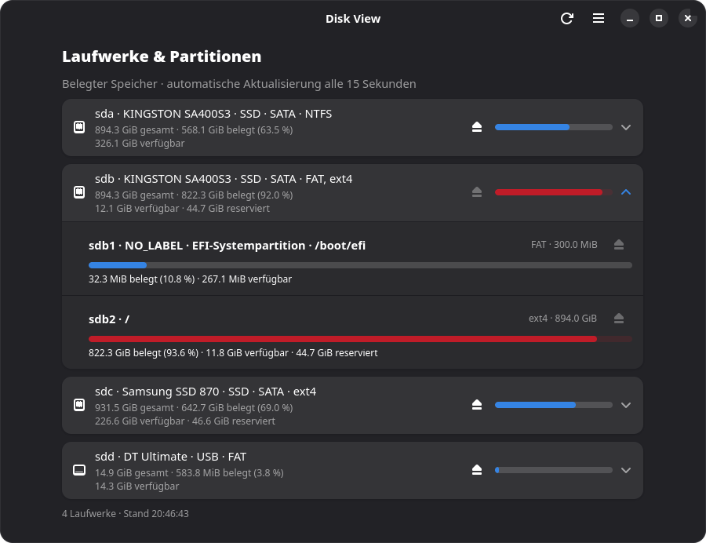

<div align="center">
  
</div>

# Disk View

[](https://github.com/magynhard/disk-view.cr/releases)
[](https://crystal-lang.org/)
[](https://www.gtk.org/)
[](https://gnome.pages.gitlab.gnome.org/libadwaita/)
[](#requirements)
[](LICENSE)

A small GTK4/libadwaita application written in Crystal for Linux.
The interface follows your system language. Disk usage is displayed using
native horizontal GTK progress bars.



## Features

- Mounted local filesystems and common network mounts, including total, used,
  available and reserved space when reported by the filesystem.
- Unmounted disks and partitions, including their capacity. Usage becomes
  available after mounting a filesystem using its mount button or another app.
- Mount/unmount buttons on each partition and a collective button per drive.
  A mixed drive mounts its remaining eligible filesystems; when all are mounted,
  the collective action unmounts them. Operations run asynchronously in sequence.
- Filesystem types and volume labels from the udev cache, including unmounted
  NTFS/exFAT/FAT volumes. Windows data, Microsoft reserved (MSR), recovery and EFI
  partitions are identified by their partition types; SSD/HDD media is shown
  when the kernel reports it. BitLocker containers are marked locked or mapped.
- Compact drive groups (`sda`, `sdb`, NVMe, etc.) with indented partitions,
  physical drive capacity and aggregated filesystem usage. Partial totals are
  explicitly marked when some partitions cannot be measured.
- Native Adwaita expander rows start collapsed. Click a drive to reveal its
  partitions; your expansion choices are preserved across refreshes in the
  current session.
- Bind mounts and subvolumes of the same filesystem are grouped together.
- Automatic refresh every 15 seconds and a manual refresh button.
- Light and dark appearance follow the system preference, including live changes,
  using libadwaita's default color scheme.
- Asynchronous filesystem queries so slow network mounts do not block the UI.
- Runs as a normal desktop application. Mount/unmount requests use UDisks2 and
  the system's polkit authorization dialog.
- Original scalable application icon, desktop launcher and an Adwaita About
  dialog with author, version and license information.
- English, German, French, Spanish, Simplified Chinese, Russian, Italian,
  Polish, Korean and Japanese translations, selected using your system locale.

## Requirements

Linux, Crystal 1.20+, Shards, GTK4, libadwaita 1.5+, libudev and GObject Introspection.
Mount/unmount actions additionally require UDisks2, a system D-Bus and a desktop
polkit authentication agent. Discovery and usage display work without UDisks2.
Building also requires GNU gettext tools and `glib-compile-resources` (provided
by the GLib development packages); the icon is embedded in the executable.

On Arch / Manjaro:

```sh
sudo pacman -S --needed base-devel crystal shards gtk4 libadwaita gobject-introspection gettext systemd-libs udisks2 polkit
```

On Debian / Ubuntu:

```sh
sudo apt install build-essential crystal shards libgtk-4-dev libadwaita-1-dev libgirepository1.0-dev gobject-introspection gir1.2-gtk-4.0 gir1.2-adw-1 gettext libudev-dev udisks2 polkitd
```

Your distribution may require installing a current Crystal compiler and Shards
separately. A graphical session is required to run the application.

## Run

```sh
make setup
make run
```

`make setup` downloads the Crystal bindings and generates them for your installed
GTK version. Run it again after updating the dependencies or system libraries.

For the correct icon in the desktop dock/taskbar, install the application once
using the user installation below. This registers the desktop entry and icon
with the desktop shell, including for subsequent `make run` launches. The
embedded icon alone is sufficient for the About dialog, but desktop shells
such as GNOME on Wayland look up the application's installed desktop entry.
Restart Disk View after installing it.

```sh
make build                         # Creates bin/disk-view
./bin/disk-view
make test                          # Headless discovery/parser and usage tests
crystal tool format --check src/ spec/
```

Use the header-bar menu for **About Disk View**, refresh and close. Keyboard
shortcuts: `Ctrl+R` to refresh, `F1` for About, and `Ctrl+W` to close.

The play/stop buttons mount and unmount filesystems. Reserved partitions, locked
encrypted containers, swap, mapped backing devices and running system mounts
such as `/` and `/boot/efi` are excluded. Current mount points are rechecked via UDisks
before each operation. Busy filesystems fail normally; no forced unmount is used.
Other mount buttons are disabled while a batch is running. The view refreshes
after completion, preserving expanded groups. If one operation fails, remaining
operations are attempted and the individual failures are shown; completed
operations are not rolled back. Closing the window or dismissing a polkit
authorization dialog stops subsequent requests.

## Install

Install the executable, desktop launcher and icon for your user:

```sh
make install PREFIX="$HOME/.local"
```

Ensure `~/.local/bin` is on your `PATH`. For a system-wide installation use
`sudo make install` (default prefix: `/usr/local`). Uninstall with
`make uninstall PREFIX="$HOME/.local"`, or `sudo make uninstall` respectively.
Translations are installed under `share/locale` relative to the installation
prefix. The executable needs no source files; when distributing it, include
the translation catalogs to retain localized interfaces.

## Releases

Download the Linux x86_64 archive from [GitHub Releases](https://github.com/magynhard/disk-view.cr/releases).
It contains the executable, all ten translation catalogs, the desktop launcher,
icon and license. Extract it and run `./bin/disk-view`; GTK4, libadwaita and libudev must
be installed. Keep `bin/` and `share/` together so translations can be found.
The separate executable download uses English unless translation catalogs are
also installed under the corresponding `share/locale` directory.

Build an optimized executable from source with:

```sh
make build CRYSTAL_FLAGS="--release --no-debug"
```

## Translations

GNU gettext selects the interface language at startup using `LANGUAGE`,
`LC_ALL`, `LC_MESSAGES` and `LANG`. Unsupported languages fall back to English;
the `C` and `POSIX` locales use English. The requested system locale must be
installed on the machine. GTK/Adwaita also use their own system translations.

To test another language with an available UTF-8 locale:

```sh
LC_ALL=en_US.UTF-8 LANGUAGE=fr ./bin/disk-view
LC_ALL=en_US.UTF-8 LANGUAGE=ja ./bin/disk-view
```

Close an existing Disk View instance first, since subsequent launches activate
the existing application. Korean and Japanese use standard `ko` and `ja`
catalog names (the same languages listed as `kr` and `jp` in Goblin Converter).

Catalog sources are in `po/<language>/LC_MESSAGES/`. `make build` and `make test`
compile them automatically. During development, catalogs are read from `po/`;
installed binaries find them relative to their own installation prefix.

```sh
make locales                       # Compile and validate PO → MO catalogs
make generate_locales              # Extract messages and update existing PO files
```

After changing translatable strings, run `make generate_locales`, complete the
translations and run `make test`. Add source files containing translation calls
to `po/POTFILES`, and add new language codes to `po/LINGUAS`. Translations use
named placeholders such as `%{size}`; keep their names and escape literal
percent signs as `%%` in formatted messages. Locale-dependent specs require
an installed non-C UTF-8 locale and are marked pending if none is available.

## Scope

Discovery uses `/proc/self/mountinfo`, `/proc/swaps`, `/sys/class/block` and
libudev cached device properties. Metadata is read without mounting, unlocking
or directly probing drives. If udev has no cached identification data, the
application still lists devices using sysfs and mounted-filesystem information.
NTFS drivers such as `ntfs3` and `ntfs-3g`/`fuseblk` are displayed as NTFS when
identified; disk usage is read through the existing mount, just like for Linux
filesystems. Drive letters such as `C:` are Windows configuration, not inferred
from NTFS or partition labels. Filesystem-less MSR partitions are excluded from
usage totals; unmounted data and recovery partitions remain explicitly unknown.
Pseudo-filesystems, RAM disks and loop/Snap images are hidden. Partitions are
grouped using sysfs parent relationships, with numeric partition ordering.
Mapped devices (LVM, RAID, encryption) form separate groups; their underlying
partitions are identified as in use, without attributing the mapped filesystem's
usage to a physical device. Filesystem capacities larger than their backing
partition are excluded from drive totals to avoid counting an entire storage
pool as one disk's usage. A drive's percentage uses its physical capacity;
unpartitioned capacity is not counted as available filesystem space. Unknown
partition usage is never counted as free space.
Only filesystems visible in the application's mount namespace can be listed.
Capacity and occupancy are filesystem values, not directory-size estimates.
The application does not scan directory trees, modify partitions, unlock encrypted
containers or power off drives. Mount/unmount operations happen only after clicking
the corresponding action button and use the system's standard authorization.

## Author and license

Created by [Matthäus J. N. Beyrle](https://github.com/magynhard).
Released under the [MIT License](LICENSE). The application icon is original
SVG artwork distributed under the same license.
